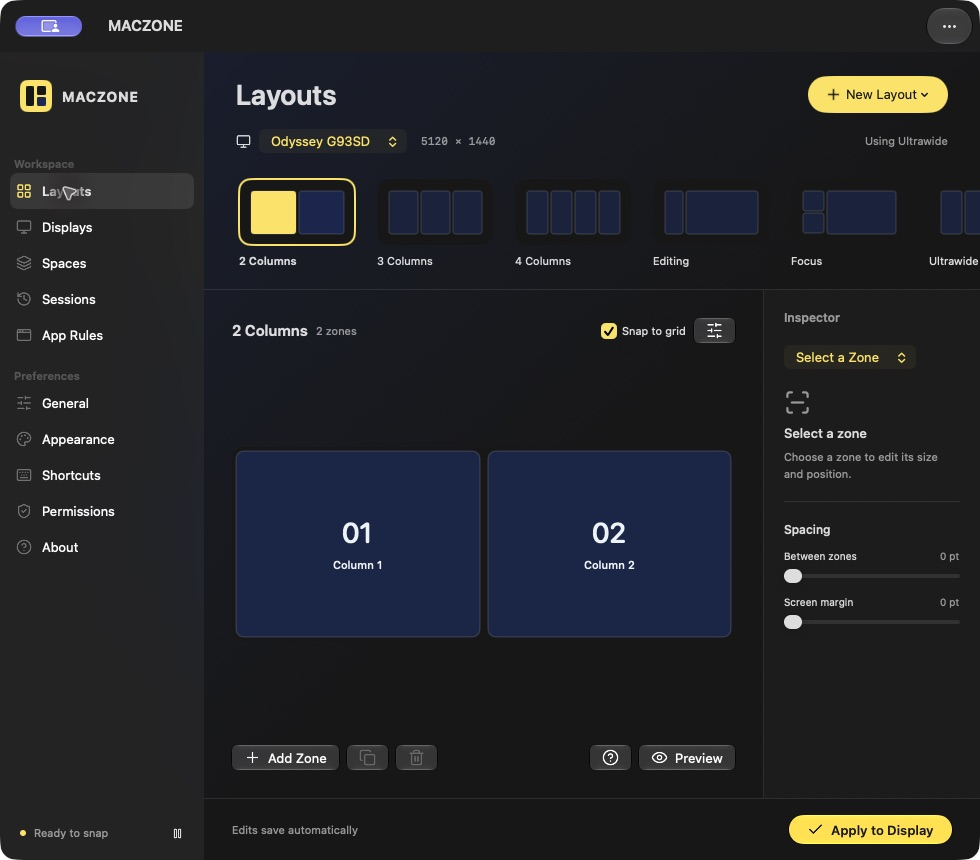
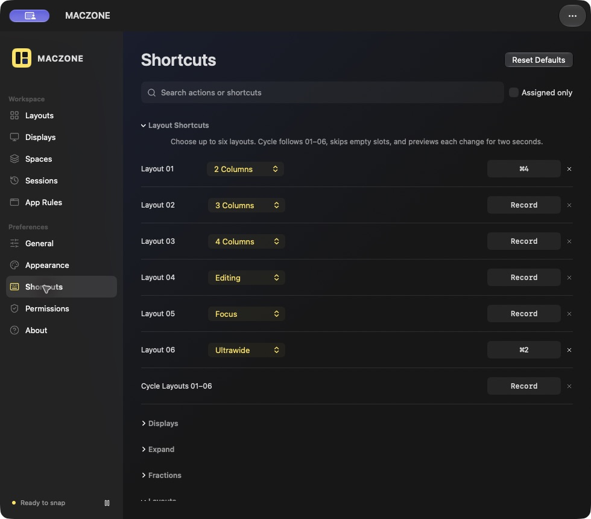
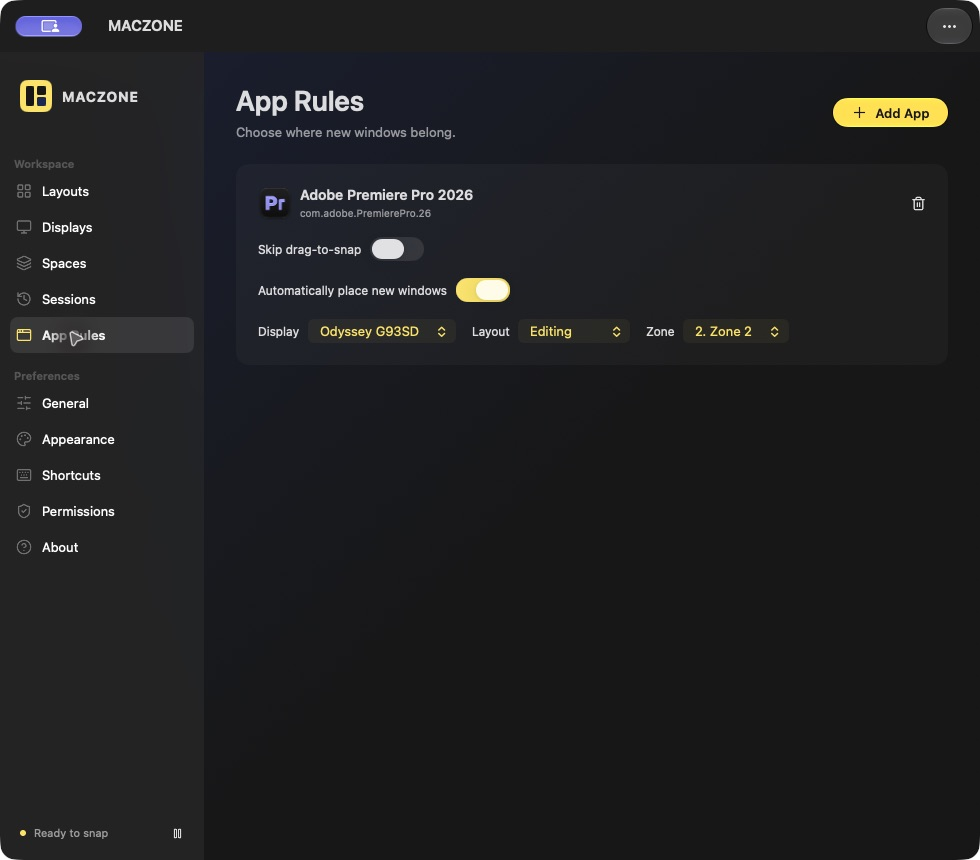

# MACZONE — visual window layouts for macOS

MACZONE (Mac Zone) is an open-source, native macOS window manager for arranging app windows in custom zones. Design layouts visually, snap windows by dragging or keyboard shortcut, and keep different setups for your displays and Spaces. It runs from the menu bar.

[Download the macOS preview DMG](https://github.com/mohsinakbar455/MACZONE/releases/tag/v0.1.0) · [Download the Alfred workflow](alfred/MACZONE%20Layouts.alfredworkflow) · [View the source](Sources/MACZONE)



## What you can do

- **Create layouts visually.** Add, resize, duplicate, and name zones; import or export layouts as JSON.
- **Snap and arrange windows.** Drag to zones, use a grid from the menu bar, or assign shortcuts for zones, fractions, displays, and layout cycling.
- **Remember your workspace.** Assign layouts per display or Space, save window sessions, and set per-app rules for new windows.
- **Adjust neighboring windows.** Drag a shared divider to resize or use its menu to swap windows.
- **Use Alfred.** Select any of six assigned layout slots or cycle them with the included workflow.

| Layout shortcuts | App rules |
| --- | --- |
|  |  |

## Download and install

**Requirements:** Apple Silicon Mac, macOS 26 or later. MACZONE is a menu-bar app, so it does not appear in the Dock. Moving other apps' windows requires macOS Accessibility permission (called **Device Control and Data Access** on macOS 27).

1. Download the DMG from the [v0.1.0 preview release](https://github.com/mohsinakbar455/MACZONE/releases/tag/v0.1.0).
2. Open the DMG and drag **MACZONE.app** to **Applications**.
3. Open MACZONE from Applications. Grant its requested window-control permission in System Settings. Its menu-bar icon opens the layout grid and settings.

**Preview build notice:** The downloadable DMG is ad-hoc signed because this project does not yet have a Developer ID certificate or Apple notarization. macOS Gatekeeper may prevent it from opening normally. In System Settings → Privacy & Security, use **Open Anyway** for MACZONE after your first launch attempt, then confirm you want to open it. Do not disable Gatekeeper globally. The [source build](#build-from-source) is also available. A Developer ID signed, notarized release is planned.

This app is still a preview. It has no automatic updater, license server, checkout, or Intel build. It cannot control true full-screen windows, docked internal panels, or windows that an app does not expose as movable and resizable.

## Alfred workflow

Install MACZONE in `/Applications` first, then download and double-click [MACZONE Layouts.alfredworkflow](alfred/MACZONE%20Layouts.alfredworkflow). Alfred's Powerpack is required for workflows.

| Alfred command | Action |
| --- | --- |
| `mzcycle` | Cycle through assigned layout slots |
| `mzlayout 1` … `mzlayout 6` | Select a layout slot |
| `mzsettings` | Open MACZONE shortcut settings |
| Control–Option–L | Default workflow hotkey for cycling |

Assign your layouts in **MACZONE → Shortcuts → Layout Shortcuts**. If Alfred owns Control–Option–L, clear the same binding inside MACZONE to avoid a shortcut conflict. The workflow uses MACZONE's `maczone://` URL commands and includes its script in the downloadable file. It does not simulate key presses.

## Common questions

**Is MACZONE free?** Yes. MACZONE is open source under GPL-3.0, with source and downloadable previews on GitHub.

**Can I use it without Alfred?** Yes. All window management features work in the MACZONE app. The Alfred workflow is an optional shortcut to its layout commands.

**Does it work on Intel Macs?** The current preview is Apple Silicon only. It requires macOS 26 or later.

## Build from source

Requires Apple command-line tools with a macOS 26+ SDK. This build targets Apple Silicon.

```sh
bash scripts/build.sh
open build/MACZONE.app
bash scripts/test.sh
```

To make a DMG locally: `bash scripts/package-dmg.sh`. A distribution build needs your own Developer ID signing identity and notarization; the default build is ad-hoc signed for development. App data is stored at `~/Library/Application Support/MACZONE/library.json`.

## About and license

MACZONE is GPL-3.0 licensed and based on [MacsyZones](https://github.com/rohanrhu/MacsyZones) by Oğuzhan Eroğlu. The original project readme is preserved in [docs/UPSTREAM_README.md](docs/UPSTREAM_README.md). Window drag handling also adapts [TilingGlass](https://github.com/gitpcl/tilingglass); see [its notice](Resources/TilingGlass-NOTICE.txt). Bundled Lucide icons retain their license notices in `Resources/Lucide`.

Issues and feature requests are welcome in [GitHub Issues](https://github.com/mohsinakbar455/MACZONE/issues). See [CONTRIBUTING.md](CONTRIBUTING.md) and [SECURITY.md](SECURITY.md) before contributing or reporting a vulnerability.
